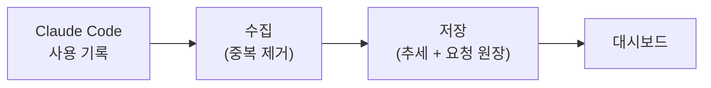
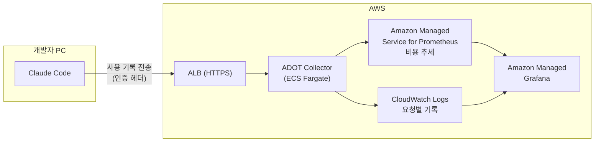

# AI DevTool FinOps

**AI 코딩 도구(Claude Code)에 쓴 돈을 정확하게 모아서, "누가, 어떤 모델로, 얼마를 썼고, 지난번보다 늘었는지 줄었는지"를 보여주는 비용 관리 시스템입니다.**

> 상태: 기획 단계 (구현 전)
> 이 문서는 프로젝트의 큰 방향을 잡는 기획서입니다. 구현하면서 달라지는 부분은 맨 아래 [설계 변경 기록](#8-설계-변경-기록)에 이유와 함께 남깁니다.

---

## 한눈에 보기

| 질문 | 답 |
|---|---|
| **무엇을 만드나** | AI 코딩 도구 사용 비용을 사람·팀·모델별로 모아 보여주는 대시보드 |
| **왜 만드나** | 사용 기록을 그대로 합쳤더니 비용이 실제보다 **2.24배** 부풀려져 있었습니다. AI 비용은 모으는 단계부터 틀릴 수 있습니다 |
| **무엇이 다른가** | ① 숫자가 정확한지부터 검증합니다 ② 다른 팀과 비교하지 않고 **자기 과거와 비교**합니다 |
| **어떻게 만드나** | AWS 서버리스 구조 (직접 관리할 서버 없음), Terraform으로 코드화 |
| **어디까지 하나** | Phase 1: 사람·팀 단위 비용 관측 (1~2주) → Phase 2: PR·릴리즈 단위로 쪼개기 |

---

## 1. 문제: AI 비용 숫자는 그대로 믿을 수 없다

**내 Claude Code 사용 기록을 그대로 더하면 비용이 실제보다 2.24배 크게 나왔습니다.**

내 Claude Code 로컬 대화 기록(2026-09-01 ~ 09-28, 로그 파일 7개, 약 18,000줄)을 직접 분석했습니다.

| | 중복 제거 전 | 중복 제거 후 |
|---|---|---|
| 비용 기록 건수 | 3,875건 | 1,887건 (51.3%가 중복) |
| 합계 비용 | $2,066.98 | $923.43 |

**원인**: Claude Code는 AI 응답 1건을 여러 조각(생각, 답변, 도구 호출)으로 나눠 저장하는데, 조각마다 같은 사용량을 반복해서 적습니다. 그래서 그대로 더하면 같은 응답의 비용이 여러 번 더해집니다.

**해결**: 응답 고유 ID(`message.id`, `requestId`)로 중복을 제거했습니다.

> 비용은 API 정가로 환산한 금액이고 실제 결제액이 아닙니다. 로컬 기록에 남지 않는 백그라운드 요청 비용은 빠져 있습니다.

이 경험 때문에 이 프로젝트는 **화려한 대시보드보다 숫자가 정확한지를 먼저** 챙깁니다.

---

## 2. 해결 방향: 무엇을 만드나

**Claude Code가 내보내는 사용 기록을 AWS로 모아, 중복 없이 집계하고, 대시보드로 보여줍니다.**

### 대시보드에서 볼 수 있는 것

1. **누가 얼마 썼나**: 사람별·팀별·모델별 하루 AI 비용과 토큰 사용량
2. **지난번보다 늘었나 줄었나**: 이번 주 비용 vs 같은 사람·팀의 직전 4주 평균
3. **어떤 모델을 쓰나**: 모델별 요청 수, 요청 1건당 평균 비용, 캐시 활용 비율
4. **숫자를 믿어도 되나**: 두 가지 방식으로 낸 합계가 서로 맞는지, 사용자·팀 정보가 빠진 기록이 몇 건인지

### 왜 "자기 과거"와 비교하나

**팀끼리 비교하면 공정하지 않고 부작용이 생기기 때문입니다.**

Amazon의 CTS-SW(Cost to Serve Software)라는 방법을 참고했습니다. 소프트웨어를 고객에게 한 번 내보내는 데 드는 총비용을 재고, **다른 팀이 아니라 그 팀의 과거와 비교**합니다.

- 팀마다 하는 일이 달라서 팀끼리 비교하면 공정하지 않습니다.
- 다른 팀과 경쟁시키면 숫자를 맞추려고 의미 없는 작업을 늘리는 문제가 생깁니다.

이 프로젝트는 총비용 중 **AI 도구 비용만** 떼어서 같은 방식으로 봅니다.

---

## 3. 진행 계획

**작게 만들어서 먼저 공개하고, 기능을 하나씩 붙입니다.**

### Phase 1: 사람·팀 단위로 비용 관측 (목표 1~2주)

**Claude Code가 스스로 내보내는 사용 기록(OpenTelemetry 텔레메트리) 하나만으로 수집합니다.**

- 요청마다 모델, 비용, 토큰 수, 요청 ID가 남습니다.
- 팀 정보는 설정으로 붙입니다.
- 내 실제 사용은 구독 요금제라, 이 방식이 내 데이터를 모을 수 있는 경로입니다.

이 단계에서는 **"효율이 좋아졌다"를 판단하지 않습니다.** 비용이 늘었는지 줄었는지만 봅니다. 효율을 말하려면 "그 돈으로 무엇을 몇 개 만들었나"(분모)가 필요한데, 그건 Phase 2에서 붙입니다.

**완료 기준**
- 같은 기록을 두 번 넣어도 합계가 바뀌지 않는다.
- 빠진 기록과 사용자 정보가 없는 기록을 대시보드에서 확인할 수 있다.
- 문서대로 따라 하면 전체 환경을 Terraform으로 다시 만들 수 있다.
- 사람·팀·모델별 비용 추세 대시보드가 동작한다.

> 실측 데이터는 나 한 명뿐이라, 팀 화면 검증에는 합성 데이터를 씁니다. 합성 데이터는 화면과 문서에 합성임을 표시하고 실측값과 섞지 않습니다.

### Phase 2: 더 작은 단위로 쪼개고 기능 확장

**"PR 하나, 릴리즈 하나에 AI 비용이 얼마 들었나"를 붙입니다.**

1. **PR·릴리즈 단위 비용**: AI 요청과 Git 커밋·PR을 맞춰 연결합니다. 확실한 근거가 있을 때만 연결하고, 연결하지 못한 비용은 이유와 함께 따로 보여줍니다.
2. **출시 1건당 AI 비용**: 기간 내 전체 AI 비용 ÷ 출시된 PR·릴리즈 수. 연결하지 못한 비용도 빼지 않습니다(빼면 효율이 좋아 보이는 착시가 생깁니다).
3. **LLM Gateway 수집 경로 추가**: 회사처럼 API 키를 쓰는 환경을 위한 두 번째 수집 방법입니다. 두 방법의 결과를 서로 대조합니다.
4. **조건을 맞춘 모델 비교**: 비슷한 작업을 모델별로 나눠 수행하고 비용과 결과를 비교합니다.
5. **비용 절감 방법 공유**: 비용이 크게 줄어든 사람이 무엇을 바꿨는지 기록해 다른 사람이 참고하게 합니다.
6. **알림**: 예산 초과, 평소보다 급증하면 Slack 알림
7. **다른 AI 도구 추가**: Codex 등 과금 단위가 다른 도구도 같은 형식으로 합칩니다.

LLM Gateway를 Phase 1에서 빼고 Phase 2로 미룬 이유

LLM Gateway는 AI 요청이 반드시 지나가는 중간 관문입니다. 회사에서 사람별 비용을 잴 때 많이 씁니다. 이 프로젝트에서는 오픈소스 LiteLLM Proxy를 쓸 계획입니다.

- 개발자에게는 Gateway가 발급한 개인 키를 줍니다. 실제 비용은 Gateway가 쓰는 회사의 API 계정에 토큰 단위로 청구됩니다.
- 그런데 Gateway 키 없이 주소(`ANTHROPIC_BASE_URL`)만 바꾸면 요청은 Gateway를 지나가도 **claude.ai 구독 로그인이 그대로 쓰여** 구독 기준으로 과금됩니다.
- 내 사용은 구독 요금제라 Gateway로는 사람별 비용을 잡을 수 없습니다. 그래서 Phase 1은 텔레메트리로 시작하고, Gateway는 소액 API 키로 따로 검증합니다.

과금 단위가 다른 도구를 하나로 합치는 방법 (설계안)

도구마다 과금 단위(토큰, 크레딧)와 기록 형식이 다릅니다. 원래 단위를 버리지 않고 공통 형식으로 바꿉니다.

| 필드 | 설명 |
|---|---|
| `timestamp` | 요청 시각 |
| `tool` | claude-code 등 |
| `user`, `team` | 사용자, 팀 |
| `model` | 모델 이름 |
| `usage_unit` | token / credit 등 원래 과금 단위 |
| `usage_amount` | 원래 단위 사용량 |
| `cost_usd` | 달러 환산 비용 |
| `cost_basis` | 환산 근거 (정가 표, 플랜 단가 등) |
| `source_id` | 원본 요청 ID (중복 제거용) |

크레딧 기반 도구는 플랜 단가로 달러를 환산하고, 근거를 `cost_basis`에 남겨 오차를 알 수 있게 합니다. 구독료처럼 요청 단위로 나눌 수 없는 비용을 어떻게 나눌지는 도구를 추가할 때 정합니다.

---

## 4. 아키텍처

**직접 관리할 서버 없이 AWS 관리형 서비스로 구성합니다.**

| 구성 요소 | 하는 일 |
|---|---|
| **ALB** | 개발자 PC에서 오는 사용 기록을 HTTPS로 받는 입구 |
| **ADOT Collector** (ECS Fargate) | 받은 기록을 나눠서 보냄. 추세용 숫자는 Prometheus로, 요청별 기록은 CloudWatch Logs로 |
| **Amazon Managed Service for Prometheus** | 사람·팀·모델별 비용 추세 저장 |
| **CloudWatch Logs** | 요청 하나하나의 기록 저장. 중복 확인, 재계산, 대조는 여기서 함 |
| **Amazon Managed Grafana** | 대시보드 (로그인: IAM Identity Center 또는 SAML) |
| **Terraform + GitHub Actions** | 인프라 전체를 코드로 만들고 배포 자동화 (OIDC 인증) |

**저장소를 둘로 나눈 이유**: 추세를 빠르게 보는 데는 시계열 DB(Prometheus)가 맞고, "이 요청이 두 번 세어졌나"를 확인하려면 요청 하나하나가 남은 기록(CloudWatch Logs)이 필요합니다.

**Prometheus를 고른 이유**: AWS의 다른 시계열 DB인 Timestream for LiveAnalytics는 2025-06-20부터 신규 고객을 받지 않고, 대안인 Timestream for InfluxDB는 서버(인스턴스) 기반이라 서버리스 목표와 맞지 않습니다.

### 왜 서버리스인가

**서버를 직접 관리하지 않아도 되고, 사용자가 늘어도 서버를 새로 준비할 필요가 없기 때문입니다.**

| | EC2(가상 서버) 직접 운영 | 이 프로젝트 (서버리스) |
|---|---|---|
| 관리할 것 | OS 패치, 디스크, 프로세스 감시 | 컨테이너 이미지와 설정만 |
| 사용자가 늘면 | 서버 크기·대수를 미리 정해서 늘림 | Collector 컨테이너 수를 늘리고, 저장은 관리형 서비스가 받아줌 |
| 장애가 나면 | 대체 서버를 직접 준비 | 문제 생긴 컨테이너를 ECS가 자동 교체 |
| 다시 만들 때 | 수동 설정이 남기 쉬움 | Terraform으로 똑같이 다시 만듦 |

서버리스의 한계 (규모가 커질 때 같이 봐야 할 것)

- Fargate는 요청이 없어도 실행 중인 컨테이너에 과금됩니다. 사용량이 많고 일정하면 같은 사양의 EC2보다 비쌀 수 있습니다.
- 사용자가 늘면 컨테이너 수만 늘리면 되는 게 아닙니다. 사용자 × 모델 × 팀 조합이 많아질수록 Prometheus 비용이 늘고, 입구 처리량과 로그 저장 비용도 함께 늘어납니다.
- AWS 관리형 서비스에 묶이는 부분이 생깁니다.

이 비교는 구현 후 실제 월 비용으로 확인합니다.

---

## 5. 설계 원칙

**숫자를 믿을 수 있게 만드는 원칙 세 가지입니다.**

1. **같은 비용은 한 번만 센다**
   - 요청 기록은 요청 ID 기준으로 한 번만 셉니다. 같은 기록이 다시 들어와도 합계가 바뀌지 않아야 합니다.
   - Claude Code가 주는 "비용 합계 숫자"와 "요청별 비용 기록"은 각각 따로 계산하고 서로 더하지 않습니다. 둘은 맞는지 대조하는 데만 씁니다.
   - 과거 로컬 기록(1번 분석)은 새 기록과 수집 범위가 달라서 같은 기준선에 섞지 않습니다.
2. **다른 팀이 아니라 자기 과거와 비교한다**
3. **연결하지 못한 비용을 숨기지 않는다** (Phase 2): 작업에 연결하지 못한 비용도 이유와 함께 보여주고, 효율 계산에서 빼지 않습니다.

> 비슷한 상용 도구와 Anthropic 공식 분석 기능도 있습니다. 상용 도구와의 구체적인 기능 비교는 구현 전에 직접 확인한 뒤 확정합니다.

---

## 6. 초기 기획에서 바뀐 점

**처음에는 "PR 하나에 AI 비용이 얼마 들었나"부터 만들려고 했습니다. 멘토링을 거쳐 "사람·팀 단위로 정확하게 재기"부터 시작하는 것으로 바꿨습니다.**

| 항목 | 처음 | 지금 |
|---|---|---|
| 시작 단위 | PR 단위 | 사람·팀 단위 (PR은 Phase 2) |
| 비교 기준 | 없음 | 자기 과거 대비 |
| 수집 방법 | 로컬 기록 + Git 기록 맞추기 | Claude Code 텔레메트리 (Gateway는 Phase 2) |
| 인프라 | EKS + ArgoCD로 직접 운영 | 서버리스 (Fargate + 관리형 서비스) |
| 진행 방식 | 한 번에 전체 구현 | 작게 만들어 공개하고 기능 추가 |

**바꾼 이유**: PR 단위 연결은 어렵고, 현업에서도 사람·조직 단위로 먼저 잽니다. 정확하게 재는 기반을 먼저 만들고 그 위에 작은 단위를 올리는 편이 맞다고 판단했습니다.

---

## 7. 결과 (완료 후 기입)

- 두 집계 방식의 차이: (완료 후 기입)
- 기준선 대비 비용 변화: (완료 후 기입)
- 모델별 요청 1건당 평균 비용: (완료 후 기입)
- 인프라 월 비용: (완료 후 기입)
- 환경을 처음부터 다시 만드는 데 걸린 시간: (완료 후 기입)

---

## 8. 설계 변경 기록

구현하면서 이 기획과 달라진 부분을 남깁니다.

| 날짜 | 바꾼 내용 | 이유 |
|---|---|---|
| - | (구현 시작 후 기입) | - |

---

## 참고 자료

**Claude Code**
- Analytics: https://code.claude.com/docs/en/analytics
- OpenTelemetry 모니터링: https://code.claude.com/docs/en/monitoring-usage
- LLM Gateway (구독과 Gateway 과금): https://code.claude.com/docs/en/llm-gateway
- Gateway 연결: https://code.claude.com/docs/en/llm-gateway-connect

**방법론**
- Amazon Science, CTS-SW: https://www.amazon.science/blog/measuring-the-effectiveness-of-software-development-tools-and-practices
- AWS, CTS-SW 15.9% 사례: https://aws.amazon.com/blogs/enterprise-strategy/business-value-of-developer-experience-improvements-amazons-15-9-breakthrough/
- FinOps Foundation: https://www.finops.org/
- AI FinOps와 AI Gateway: https://www.cloudnetworks.co.kr/pr/blog/?mod=document&uid=441

**AWS**
- Prometheus 수집 (ADOT Collector): https://docs.aws.amazon.com/prometheus/latest/userguide/self-managed-collectors.html
- Managed Grafana 인증: https://docs.aws.amazon.com/grafana/latest/userguide/authentication-in-AMG.html
- Fargate와 Lambda 비교 (과금 방식): https://docs.aws.amazon.com/decision-guides/latest/decision-guides/fargate-or-lambda.html
- Timestream for LiveAnalytics 가용성 변경: https://docs.aws.amazon.com/timestream/latest/developerguide/AmazonTimestreamForLiveAnalytics-availability-change.html

**관련 도구**
- LiteLLM 비용 추적: https://docs.litellm.ai/docs/proxy/cost_tracking
- Git AI, PR별 토큰 비용: https://usegitai.com/blog/token-cost-by-pull-request
- GitHub ai-finops 토픽: https://github.com/topics/ai-finops
